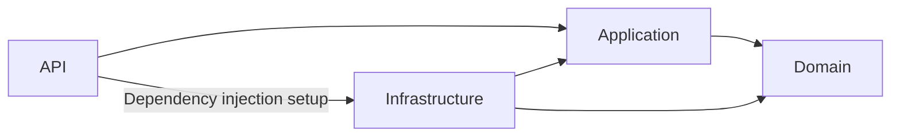

# CookEase

CookEase aims to make preparing a meal simple and stress-free by helping users understand what is in their refrigerator, track expiration dates, discover recipes, and plan their meals from start to finish.

## Project goals

- **Know your refrigerator:** Keep an inventory of refrigerated ingredients and track each item's expiration date so users know what they have and what needs to be used soon.
- **Get personalized recipe recommendations:** Suggest recipes based on available ingredients, upcoming expiration dates, and the user's taste and flavor preferences.
- **Search for recipes:** Let users find and add recipes they want to cook to their meal plans.
- **Calculate ingredient quantities:** Automatically scale the ingredients for selected recipes according to the number of people eating.
- **Cook with step-by-step guidance:** Provide clear cooking instructions and notifications that guide users through each next step until the meal is complete.
- **Plan meals ahead:** Let users organize upcoming meals and prepare in advance.
- **Generate shopping lists:** Automatically create shopping lists from planned meals and serving counts, accounting for ingredients already available in the refrigerator.

## Intended experience

From checking the refrigerator to serving a finished meal, CookEase should give users the information and guidance they need in one place. The goal is to reduce food waste, simplify shopping and meal planning, and make everyday cooking feel effortless.

## Technology stack

| Area | Choice |
| --- | --- |
| Backend language and framework | C# with ASP.NET Core on .NET 10 LTS |
| Backend architecture | Clean Architecture: Domain, Application, Infrastructure, and API |
| Database | PostgreSQL 18 |
| Data access | Entity Framework Core 10 with the Npgsql PostgreSQL provider |
| Local environment | Docker Compose with separate API and database containers, grouped as `cookease` |
| Frontend | Native iOS application; language/framework selection and implementation are deferred |

The iOS application will run on an Apple device or simulator, outside Docker. Docker Desktop runs the backend and database using Linux containers.

## Backend structure

Open `CookEase.sln` in Visual Studio or your preferred .NET editor.

```text
Backend/
  Dockerfile
  src/
    CookEase.Domain/          Business entities, value objects, and rules
    CookEase.Application/     Use cases and interfaces for external dependencies
    CookEase.Infrastructure/  PostgreSQL, EF Core, and future external service clients
    CookEase.Api/             HTTP endpoints and dependency injection setup
```

Project references point inward:



Domain has no project or external package dependencies. Application references only Domain. Infrastructure implements Application interfaces and owns database access. API references Infrastructure to register implementations at startup; feature endpoints should call Application use cases.

Domain contains `User`, `FridgeItem`, `StorageLocation`, and `MeasurementUnit`. Application exposes the `ICurrentUser` interface for the signed-in user's ID. Infrastructure provides `CookEaseDbContext`, database health checks, and ASP.NET Core Identity services with EF Core account storage and cookie/bearer authentication support. No authentication endpoints are exposed yet.

`CookEaseDbContext` applies a global ownership filter to normal EF queries for `FridgeItem`, using the authenticated user's ID from `CurrentUser`. Missing, invalid, or unauthenticated identities see no items. Repositories do not need repeated owner predicates. The filter applies only to fridge items, leaving Identity account lookups available for login. Keep each context scoped to one request/user. This is query filtering, not write authorization: create items with the signed-in user's ID and load existing items through filtered queries before updating or deleting them. `IgnoreQueryFilters()` explicitly bypasses the filter and must not be used in ordinary user-facing operations.

The model links an Identity account (`AspNetUsers`) to a domain profile (`UserProfiles`) using the same primary key, and each profile owns many `FridgeItems`. Deleting an account cascades to its profile and inventory; deleting an individual item does not delete its owner. Identity owns email and password hashes. Future registration must create the account and matching profile together, and future use cases must enforce ownership. Migrations have not been created or applied, so these tables do not exist in the database yet.

## Fridge-item endpoints

The controller currently calls the repository directly and maps entities to response DTOs, without commands, queries, or an application service. All inventory endpoints require authentication.

| Method | Route | Successful response |
| --- | --- | --- |
| GET | `/api/fridgeItems` | 200 with the user's items |
| GET | `/api/fridgeItems/{id}` | 200 with one item |
| POST | `/api/fridgeItems` | 201 with the created item and its Location header |
| PUT | `/api/fridgeItems/{id}` | 204 after updating the item |
| DELETE | `/api/fridgeItems/{id}` | 204 after deleting the item |

POST and PUT accept `SaveFridgeItemDto`. PUT replaces all editable fields; an omitted or null expiration date clears it. IDs, ownership, and the original added timestamp are managed by the server.

```json
{
  "itemName": "Milk",
  "amount": 1.5,
  "unit": 5,
  "expirationDate": "2026-12-01",
  "storageLocation": 1
}
```

Units: `Piece = 1`, `Gram = 2`, `Kilogram = 3`, `Milliliter = 4`, `Liter = 5`. Storage: `Refrigerator = 1`, `Freezer = 2`, `Pantry = 3`, `Countertop = 4`. Invalid names, nonpositive quantities, and undefined enum values return 400. Missing items and items owned by another user return 404. Unauthenticated requests return 401.

HTTP tests exercise these routes with an in-memory database and test authentication. Live PostgreSQL usage still requires migrations and an authenticated account with a matching user profile; registration/login endpoints have not been exposed yet.

## Run with Docker Desktop

Requirements: Docker Desktop running with Linux containers. A local .NET SDK is only needed when building or debugging outside Docker.

1. For a new checkout, copy `.env.example` to `.env` and replace `POSTGRES_PASSWORD` with a local development password. Use letters and digits to avoid connection-string quoting issues. The initial workspace already has an ignored `.env` with a generated password. Keep this file private.
2. From the repository root, run:

   ```powershell
   docker compose up --build --detach --wait
   ```

3. Check the API:

   | Address | Purpose |
   | --- | --- |
   | [API](http://localhost:8080/) | Identifies the running CookEase API |
   | [Liveness](http://localhost:8080/health/live) | Returns `Healthy` when the API is running |
   | [Readiness](http://localhost:8080/health/ready) | Returns `Healthy` only when the API can connect to PostgreSQL; otherwise HTTP 503 |
   | [OpenAPI document](http://localhost:8080/openapi/v1.json) | Development-only API description, including the fridge-item routes |

Both containers use `restart: unless-stopped`. After the initial setup, they restart when Docker Desktop's engine starts, provided they were not explicitly stopped. A stopped project can be started from Docker Desktop or with `docker compose up --detach --wait`. After source changes, use the build command above again.

PostgreSQL data is retained in a named Docker volume. `docker compose down` removes containers but keeps the data; adding `--volumes` deletes the database data. Changing the password in `.env` does not change the password of an already initialized database.

The default local ports are `8080` for the API and `5435` for PostgreSQL. Change `API_PORT` or `POSTGRES_PORT` in `.env` if needed. Containers connect to PostgreSQL at `postgres:5432`. Both published ports are restricted to this computer; access from a physical iPhone will need separate network configuration later.

This Compose configuration is for local development and uses HTTP. Public deployment, HTTPS, and authentication will be configured separately.

Useful commands:

```powershell
docker compose ps
docker compose logs --follow api
docker compose stop
```

## Build or debug outside Docker

Install a .NET 10 SDK. `global.json` selects the latest installed stable .NET 10 SDK feature band.

```powershell
dotnet build CookEase.sln --configuration Release
```

To debug the API locally while using the Docker database, stop the API container to free port 8080 and start PostgreSQL:

```powershell
docker compose stop api
docker compose up --detach --wait postgres
$env:ConnectionStrings__CookEase = 'Host=localhost;Port=5435;Database=cookease;Username=cookease;Password="<password-from-.env>";Timeout=5'
dotnet run --project Backend/src/CookEase.Api
```

Replace the password placeholder and match any database settings changed in `.env`. The local API does not automatically load `.env`. Stop the local process before restarting the API container.

Architecture and infrastructure references: [Microsoft Clean Architecture guidance](https://learn.microsoft.com/en-us/dotnet/architecture/modern-web-apps-azure/common-web-application-architectures), [.NET support policy](https://dotnet.microsoft.com/en-us/platform/support/policy/dotnet-core), [Npgsql EF Core provider](https://www.npgsql.org/efcore/), [Docker startup ordering](https://docs.docker.com/compose/how-tos/startup-order/), and [container restart policies](https://docs.docker.com/engine/containers/start-containers-automatically/).

## Potential external resources

These are candidates for a US-first launch, not selected integrations. Coverage, recognition accuracy, pricing, and usage rights need validation before development.

| Resource | Small description |
| --- | --- |
| [Google ML Kit](https://developers.google.com/ml-kit/vision/barcode-scanning/android) | Reads barcodes on the phone; pair with a product database to identify packaged foods. |
| [Open Food Facts](https://openfoodfacts.github.io/openfoodfacts-server/api/) | Looks up food products by barcode. Incomplete records need a manual fallback; attribution and share-alike licensing requirements apply. |
| [Veryfi Receipt OCR](https://www.veryfi.com/receipt-ocr-api/) | Extracts receipt line items and available quantities. Abbreviated names and package sizes still need interpretation. Published starter pricing has a $500 monthly minimum, with a small free testing allowance; [check pricing](https://faq.veryfi.com/en/articles/3743986-what-are-the-plans-prices-for-ocr-api). |
| [Gemini image understanding](https://ai.google.dev/gemini-api/docs/image-understanding) | Candidate for recognizing visible refrigerator foods and extracting receipt details. Test against real photos; users must confirm uncertain items, quantities, and dates. |
| [GS1 barcode guidance](https://www.gs1.dk/en/vejledninger/2d-stregkoder-i-detailhandel-og-forsyningskaede) | Explains product identification and newer barcodes that can carry dates. Ordinary UPC/EAN codes do not identify an individual package's expiration date; support printed-date photos and manual entry. |
| [Spoonacular](https://spoonacular.com/food-api/docs) | Ingredient-based recipe search and analyzed cooking steps. Strong functional candidate, but [storage and caching restrictions](https://spoonacular.com/food-api/terms) require checking permission for saved meals, shopping lists, and offline cooking. |
| [Edamam](https://developer.edamam.com/edamam-recipe-api) | Offers over 2 million web recipes without cooking instructions and a separate collection of 20,000+ owned recipes with instructions. Evaluate owned content for in-app cooking; caching depends on the plan. |
| [TheMealDB](https://www.themealdb.com/docs_api_guide.php) | Recipe search and details with testing and production access options. Useful for prototyping; evaluate cuisine coverage and ingredient consistency. |
| [USDA FoodKeeper](https://www.foodsafety.gov/keep-food-safe/foodkeeper-app) | Storage guidance developed with Cornell University and the Food Marketing Institute. The [dataset catalog](https://catalog.data.gov/dataset/fsis-foodkeeper-data) lists JSON and spreadsheets; the JSON download returned an access error during research, so importing it remains unverified. |
| [FoodSafety.gov Cold Food Storage Chart](https://www.foodsafety.gov/food-safety-charts/cold-food-storage-charts) | Refrigeration and freezing guidance, with distinctions for opened, unopened, raw, and cooked foods. |
| [University of Minnesota Extension](https://extension.umn.edu/garden-and-home/yard-and-garden/gardening-in-minnesota/harvesting-and-storing-home-garden-vegetables) | Practical produce storage advice, including moisture and packaging conditions. |
| [FDA food storage guidance](https://www.fda.gov/consumers/consumer-updates/are-you-storing-food-safely) | Food-safety reference: appearance cannot establish safety. Keep printed package dates separate from estimated storage windows and base guidance on reviewed sources. |

LLM-assisted recipe discovery options:

| Approach | How it works | Fit for CookEase |
| --- | --- | --- |
| **LLM + recipe database** | The LLM interprets the request, searches a recipe service, and explains the best matches. | **Recommended for the first version:** identifiable sources and structured ingredients support shopping lists and guided cooking. |
| **LLM + web search** | The LLM searches recipe websites and returns relevant links based on the user's request and available ingredients. | Useful for broader discovery, but importing complete recipes requires checking content permissions and data quality. |

Integration considerations:

- Use a shared flow: scan, review detected foods, confirm quantities and dates, then add to inventory. Repeated refrigerator scans should reconcile existing items to avoid duplicates.
- Track storage location, food condition, purchase/opening/cooking dates, printed dates, and the source of estimated storage windows.
- Compare Spoonacular with Edamam's owned content using representative cuisines, complete instructions, ingredient quantities, servings, and licensing needs.
- CookEase must implement serving calculations, ingredient matching, and cooking notifications; recipe steps may lack usable timers.
- Validate providers with real receipts, packaged products, refrigerator photos, and representative recipes before committing.

## Project status

The backend foundation includes four Clean Architecture projects, the user and fridge-item domain models, authenticated fridge-item CRUD endpoints, Identity infrastructure, EF Core relationship mappings, PostgreSQL connectivity, health checks, and Docker Compose. Database migrations, application services, authentication endpoints, external resource integrations, and the iOS frontend remain to be implemented.
